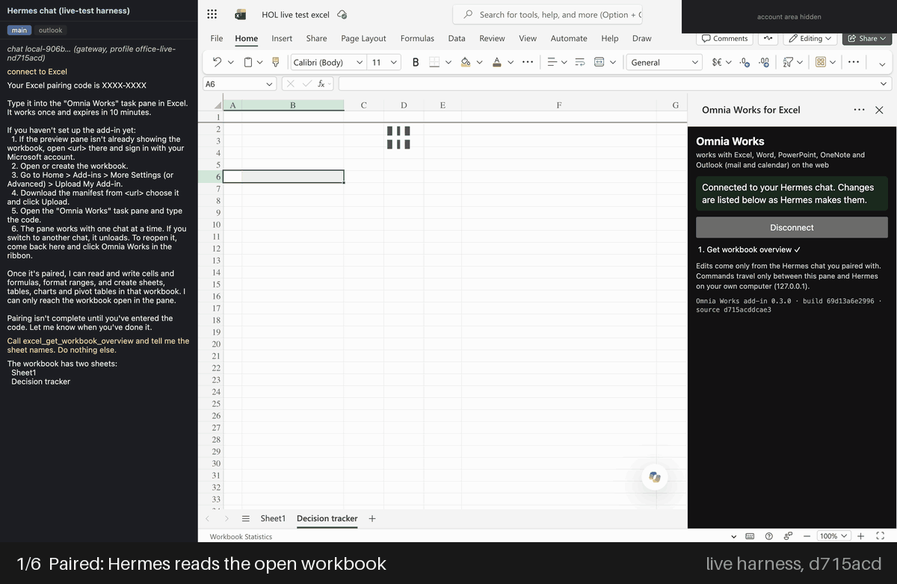

<!-- SPDX-License-Identifier: Apache-2.0 -->
# Workbench by Atlas Omnia (0.3.0)

Open and edit Word, Excel, PowerPoint, OneNote and Outlook in a Hermes Desktop tab, with your agent working alongside you.

## Judge quickstart — Excel

Public install/smoke pending:
1. `hermes plugins install https://github.com/AtlasOmnia/workbench --enable`; launch Desktop on the gateway machine.
2. Open a blank Excel workbook in a preview tab; follow **First connect** below to upload its manifest and type the pairing code.
3. Request Task/Status and Demo/Ready in A1:B2, approve, read back, then `office_undo` and read back blank cells.
Windows: **one Hermes profile at a time**.

*Workbench was formerly called Omnia Works; the manifest folder name "Omnia Works" and the older capture below are leftovers of that name.*

*Masked screenshots from the automated live test (`hol-maint-d715acd-all-3`, Excel run 1), built by
`scripts/make_readme_gif.py`, before the rename (not Hermes Desktop itself).*

## Verified live

Verified live in Excel, Word, PowerPoint and OneNote on shipped runtime 402f00e (F8, A46): all four apps 1/1 with images. Outlook (mail) and calendar standalone rows remain from 8fa1f63 (F5). See [docs/live-evidence.md](docs/live-evidence.md).

Demo story ([script](docs/demo-script.md)), 402f00e (F8, A46), bare prompts (`story-bare`), on a cold test profile (self-learning off; nothing learned): 2 of 2
runs passed all five beats, first attempt. The notes loop (`loop`): 1/1. On 0847e28 (F4) the same cold bare prompts passed 1 of 4 runs; its earlier 2/2 was
(warm) and is not the evidence. Details in
[live-evidence.md](docs/live-evidence.md#current-f8-402f00e-a45a46). Outlook calendar on 8fa1f63 (F5): 1/1, moving the
event past midnight and undoing it back over midnight; the 3/3 over midnight on 0847e28 (F4) used the same calendar code.

Run by the automated harness: a real Hermes chat and real Office for the web in an Electron window with the Desktop
preview pane's `<webview>` settings ([docs/harness.md](docs/harness.md)). Historical medians on d1f7aae (F7; Outlook rows: F5),
Hermes to pane and back (model and approval time excluded):

| App | Runs passed | In the pane | Round trip |
| --- | --- | --- | --- |
| Excel | 1/1 | 213 ms | 292 ms |
| Word | 1/1 | 1477 ms | 1518 ms |
| PowerPoint | 1/1 | 553 ms | 640 ms |
| OneNote | 1/1 | 32 ms | 56 ms |
| Outlook (mail), F5 | 1/1 | 102.5 ms | 188 ms |
| Outlook calendar, F5 | 1/1 | 172 ms | 212 ms |

An uncertain OneNote change needs a successful page read before retry (present: refused; absent: once). Open page unknown: stays held, not re-sent; reload the tab, check the page. In the real Hermes Desktop
app the bare story passed 5/5 in one chat (warm; [live-evidence.md](docs/live-evidence.md#real-hermes-desktop-session-studio-f7)). Known limits (a new calendar event is requested, not opened in the pane; the model sometimes needs a second
ask) are in [live-evidence.md](docs/live-evidence.md#current-f8-402f00e-a45a46).

## First connect (about 2 minutes per app, once)

Hermes Desktop on macOS or Windows must run on the gateway machine. Upload once per app.

1. **Install the plugin.** `hermes plugins install https://github.com/AtlasOmnia/workbench --enable`, then
   restart Hermes Desktop so it loads.
2. **Open the app in the Desktop pane.** In a Hermes Desktop chat, ask Hermes to open Excel (or Word, PowerPoint,
   OneNote, Outlook); it opens the app's direct link in the preview pane for you:

   | App | Personal Microsoft account | Work or school account |
   | --- | --- | --- |
   | Excel | `https://excel.cloud.microsoft/` | same |
   | Word | `https://word.cloud.microsoft/` | same |
   | PowerPoint | `https://powerpoint.cloud.microsoft/` | same |
   | OneNote | `https://www.onenote.com/notebooks` | same |
   | Outlook mail | `https://outlook.live.com/mail/0/` | `https://outlook.office.com/mail/` |
   | Outlook calendar | `https://outlook.live.com/calendar/0/view/week` | `https://outlook.office.com/calendar/view/week` |

   **Each extra app:** click **+** in the preview tab strip, then ask Hermes to open it; existing panes stay open.
   For a new file, click Blank workbook, Blank document or Blank presentation.
3. **Sign in to your Microsoft account** on Microsoft's own page, in the pane. The plugin never sees your password.
   If you land on the Microsoft 365 home instead of the app, Hermes opens the app's direct link for you.
4. **Upload the add-in once per app.** Nothing to download: the first "connect to <app>" writes the five manifests
   (`manifest-excel.xml`, `-word`, `-powerpoint`, `-onenote`, `-outlook`, for your add-in site) to
   **Documents > Omnia Works > add-in manifests** (plugin setting `manifest_dir` to change it; a file you edited is
   never overwritten, Hermes writes `manifest-<app> (Omnia Works).xml` beside it), and Hermes tells you the path:
   * **Excel, Word, PowerPoint:** Home > Add-ins > More Add-ins > Manage My Add-ins (on the My Add-ins tab) >
     Upload My Add-in > Browse, choose `manifest-<app>.xml` in Documents > Omnia Works > add-in manifests, then
     Upload. The Add-ins button does nothing for a few seconds after the file opens: wait, then click again.
   * **OneNote:** Insert > Office Add-ins > My Add-ins > Manage My Add-ins > Upload My Add-in > Browse, choose
     `manifest-onenote.xml` in the same folder, then Upload.
   * **Outlook:** open a message, then More apps > Get add-ins > My add-ins > Custom Addins >
     Add a custom add-in > Add from File..., choose `manifest-outlook.xml` in the same folder, then Install. Open the
     email first, then More apps > Workbench. There is no pin: the pane stays on that message. To fill a reply,
     click Reply, then open Workbench from the draft's Message tab > Apps (not Home > More apps). Email not in
     the Inbox? Search All folders.

   If Upload My Add-in is missing, your organization may block custom add-ins; try a personal Microsoft account.
5. **Pair.** Say "connect to Excel". Hermes shows an 8-character code; type it into the **Workbench** pane beside
   the document (ribbon button **Workbench** if it is closed). Only you type the code; Hermes will not. A code
   lasts 10 minutes: if the pane says "Hermes is not answering on this computer" after a wait, open the pane and ask
   for a new code.
   Tip: click the Hermes chat box before you type (an Office app, the Outlook reply editor most of all, can keep
   the keyboard), and click an app's tab when Hermes asks: it works only on the tab in front.
6. **First edit, then undo.** Say "write Item/Amount and three rows into A1:B4", approve the prompt (it names the
   app, document, range and whether it can be undone), and the cells appear, selected so you see what changed. Then say
   "undo that".

## Limits

* Each edit asks approval and returns `verified` (read back from the document), `applied` (written only), `partial`, `uncertain` or `failed`, plus undo availability.
* **Undo has exceptions.** `office_undo` reverts the newest Hermes change in that pane, one step per call, and every
  receipt says whether undo is available. Not undoable or only partly: a Word edit in a document too large to
  snapshot; an Excel edit over more than 10,000 cells (no snapshot); PowerPoint text replaced through a bare
  selection, and a slide delete that could not be exported first; a OneNote page Hermes created (you delete it by
  hand; undo opens it for you); `excel_delete_sheet` and sheet passwords. Undo history is lost when the pane
  reloads (OneNote's change ledger survives). An Outlook draft is autosaved by Outlook itself; Hermes never saves it.
* **Speaker notes are not supported.** `powerpoint_add_speaker_notes` is registered but always answers
  `Unsupported`: Office.js for the web has no speaker-notes API. Put a speaker script in Word instead.
* **Reads are capped.** Word reads at most the first 20,000 characters of the document body, and Outlook at most
  20,000 characters of a message or event body; the result says `truncated`, and Hermes tells you when a summary is
  based on a cut-off read.
* **OneNote shows no ribbon after a minute?** Reload the tab; the pane pairs itself again.
* **After a long chat** (Hermes compressed it, or you used `/rewind`) the panes answer `NotPaired`: ask Hermes to
  connect again and type the new codes.
* **Walking away for more than 10 minutes?** Leave the pane open; it finds Hermes again when you come back.
* **"Why is this here?" answers from this profile's whole index**, so `brain_why` can cite a tracker or deck an
  earlier chat in the same profile made.
* **Hermes Desktop app only**, not the browser webapp: its preview pane is a sandboxed iframe that Microsoft
  refuses to load and that cannot reach `127.0.0.1`. Hermes says so instead of giving you a code.
* **Microsoft sign-in and Upload My Add-in are required**; there is no store listing yet.
* **OneNote reads only the open page.** The local index grows as you open pages; `brain_sync` adds every page's
  title, and every answer says how many pages it has indexed.
* **Outlook reply and new drafts open as pop-outs, which the pane blocks.** You click Reply and open Workbench in
  the draft (Message > Apps); Hermes fills it in, and refuses while the pane is still on the email.
* **OneNote:** The first response confirms the tab opened and asks which notebook. If My Files is visible,
  click it for a separate window, open the notebook there, then paste its final browser address into this
  tab. Pair only once it loads here. Only My Files window-opening is user-confirmed; the full flow is
  not yet verified live in Hermes Desktop.
* **Excel refuses changes while you edit a cell.** Press Esc or click a cell. With five panes Excel can be slow;
  Hermes reads the workbook before retrying an uncertain change.
* **After Hermes restarts, pair every pane again** (pairings live in memory). A pane stuck on "Hermes is working…":
  close it and open Workbench again (reload the tab if needed).
* **Nothing is ever sent or saved for you.** Hermes never sends mail, never adds or changes recipients or
  attendees, never saves an event and never sends an invitation.
* **Five profiles per gateway share the bridge ports** (`127.0.0.1:47615-47619`); idle profiles release theirs
  after 10 minutes.
* **Use the direct links** — the Microsoft 365 app launcher opens new windows, which the pane blocks.
* **All your Office panes can share one chat.** Switching to another chat unloads them; reopen Workbench from the
  ribbon to pair again.
* Windows: one real Hermes Desktop session passed the 5-prompt story on 2026-11-10 with a single profile.
* Windows: two Hermes profiles at once are not live-tested (port 47615 is no longer bound twice).
* **No Microsoft Graph**, so no OneDrive, To Do or Teams yet, no background sync, and no other notebooks than the
  open one.

## Privacy and safety, in short

* The bridge listens on `127.0.0.1` only and accepts only the add-in's origin plus a single-use code you type,
  then a per-pane token. No Microsoft app registration, OAuth or Graph; the plugin reads no credentials and has
  no telemetry.
* Every edit asks for Hermes approval; scheduled, webhook and API-server runs are refused outright, reads too.
* OneNote pages you open while paired are indexed, unencrypted, in this profile's `brain.db`; delete it to forget.
* The only outbound request is fetching an image URL you ask Hermes to insert (public HTTPS addresses only,
  4 MiB, PNG/JPEG).
* The add-in's task pane is served from the add-in site (plugin setting `addin_base`, default
  `https://atlasomnia.github.io/workbench/office/live/`, GitHub Pages built from this repository by
  `.github/workflows/pages.yml`), outside the catalog pin; each release publishes a `SHA256SUMS` you can rebuild with
  `scripts/build_addin.py`. Self-hosting: set `addin_base` to your own site.

Full disclosures, the bridge's security, every tool and how it fits together: [docs/reference.md](docs/reference.md).

Live runs used a private add-in site; the public GitHub Pages origin is first exercised at publication.

## More

* [docs/live-evidence.md](docs/live-evidence.md): every live run, per commit.
* [docs/harness.md](docs/harness.md): unit tests and the live-test harness.
* [docs/reference.md](docs/reference.md): architecture, tools, pictures, ports, security, disclosures, layout.

`scripts/livetest/` and `spike/electron-pane-harness/` are developer-only (local paths/private hosts).

Run the tests: `python -m pytest -q -c tests/pytest.ini tests` and `node --test tests/js/*.mjs` (see
[docs/harness.md](docs/harness.md#unit-tests)).

License: Apache-2.0. Workbench is developed by Atlas Omnia. It is not affiliated with or endorsed by Microsoft or Nous Research. Microsoft, Excel, Word, PowerPoint, OneNote, and Outlook are trademarks of the Microsoft group of companies.

Also from Atlas Omnia: Hermes for LibreOffice (Calc, Writer, Impress) — separate repo.
